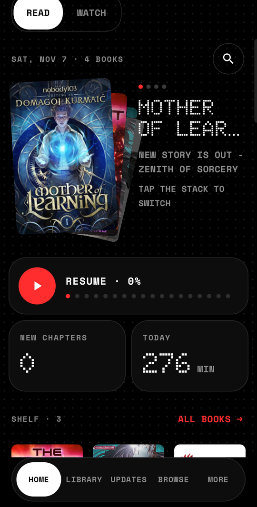
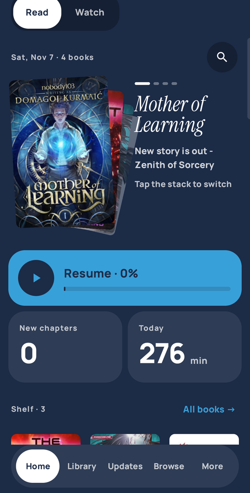
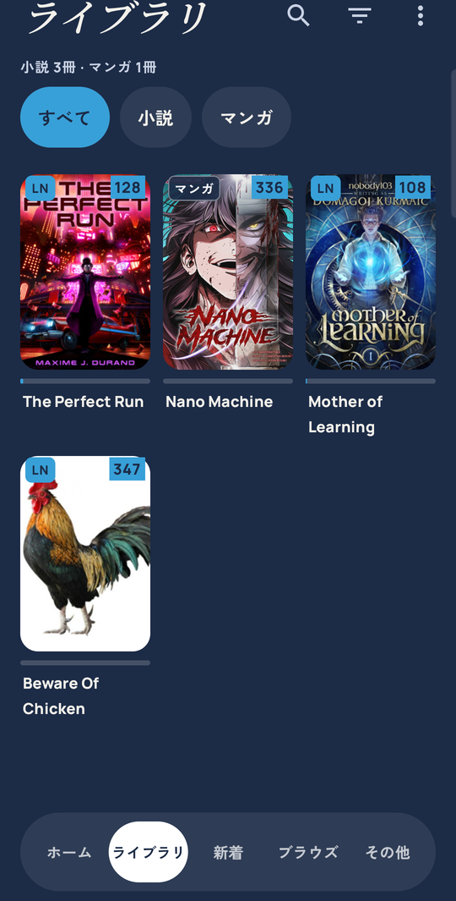
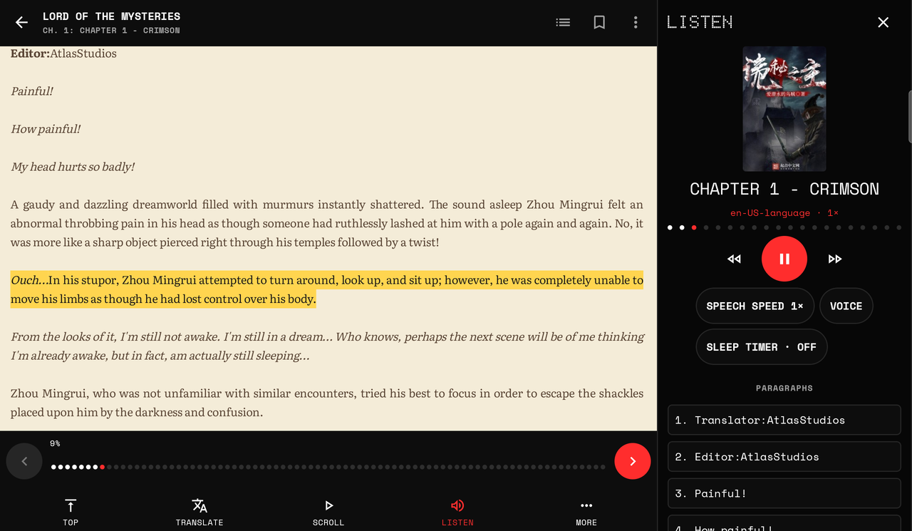

<div align="center">

# Tsuzuki · 続き

**One reader for light novels, web novels, manga and manhwa.**

*Tsuzuki* means "continuation": what happens next.

[](https://github.com/Manojx2005/Tsuzuki/releases/latest)
[](https://github.com/Manojx2005/Tsuzuki/releases)


<a href="https://github.com/Manojx2005/Tsuzuki/releases/latest">
  
</a>

<br/><br/>


&nbsp;

&nbsp;


</div>

---

## Download

1. Open the **[latest release](https://github.com/Manojx2005/Tsuzuki/releases/latest)** on your phone or tablet.
2. Under **Assets**, pick one APK:

   | File | Use it if |
   |---|---|
   | `tsuzuki-arm64-v8a-vX.Y.Z.apk` | **Almost everyone.** Any phone or tablet from the last several years. Smallest download. |
   | `tsuzuki-vX.Y.Z.apk` | You're not sure, or the one above won't install. Works on every device; bigger. |
   | `tsuzuki-armeabi-v7a-…`, `tsuzuki-x86…` | Very old 32-bit phones, or emulators / Chromebooks. |

3. Open the downloaded file. If Android asks, allow your browser or Files app to **install unknown apps**, then tap
   **Install**.
4. Open Tsuzuki and add a source repository in **Browse**. Tsuzuki comes with no repositories; you choose which ones
   to add.

**Updates:** Tsuzuki checks GitHub for new releases by itself. You can also check any time in
**Settings › About › Check for updates**, or track this repo with [Obtainium](https://github.com/ImranR98/Obtainium)
(add `https://github.com/Manojx2005/Tsuzuki`).

**Coming from another app?** Restore a Mihon or Tsundoku backup, or import an LNReader backup, from
**Settings › Data and storage**. Tsuzuki installs as its own app, so your old app keeps working while you try it.

<details>
<summary><b>Check that your download is genuine</b></summary>

Every release lists the SHA-256 of each APK in its notes. Release APKs are signed with this certificate:

```
SHA-256: FF:CD:C7:43:A6:69:78:AE:24:CD:76:0B:44:78:32:71:A3:CC:18:16:84:4C:6A:78:6C:C9:EF:71:8E:A1:F6:C7
```

`apksigner verify --print-certs tsuzuki-arm64-v8a-vX.Y.Z.apk` shows it. Android will also refuse an update signed
with any other key.

</details>

<details>
<summary><b>Preview builds</b> (newer, less tested)</summary>

Preview builds are published as **pre-releases** tagged `rNNNN`. They install as a separate app
(`io.github.manojx2005.tsuzuki.debug`) next to the stable one and update themselves to the next preview.

</details>

## Two themes, one layout

| **Dot** | **Colour** |
|---|---|
| Monochrome dot-matrix with a single red accent. Doto + Space Mono. Covers in greyscale or in colour, your choice. | The whole app takes on the colours of the book you're reading. Instrument Serif + Manrope. |

Switch instantly in **Settings › Appearance**. Japanese text gets a matching partner font in each theme.

## What's in it

**Reading**
- **300+ LNReader novel sources** running natively, plus Mihon-style extensions for manga and manhwa
- Novel reader with page colours (Book, Paper, Sepia, Sage, Night, Black, Custom), font, size, spacing and margins,
  all applied live, and the next chapter loaded ahead so it opens instantly
- **Listen**: text-to-speech that follows the text, with a sleep timer; on tablets it docks beside the page
- Manga reader with paged and long-strip modes
- Translation (on-device by default, or your own engine), EPUB / TXT import

**Library**
- **Home** with tonight's stack, one-tap resume, new chapters and today's reading time
- Library with **All / Novels / Manga**, shelves, filters, and generated covers for books without art
- **Save chapters** by count, unread, all, or a chapter-number range; downloads pause and resume per book
- Updates with a chapter preview on tablets, history, statistics and reading time
- Home-screen widgets for continuing reading and listening

**Everywhere**
- Phone **pill nav** and tablet **rail** with two-pane Settings, Updates and Browse
- **English and Japanese** interface
- Backups, trackers, migration between sources
- **No telemetry**: release builds contain no analytics or crash-reporting code ([privacy policy](PRIVACY.md))

<div align="center">

<br/><br/>


</div>

## Roadmap

- [x] **v0.1**: first public release (novels, manga, manhwa)
- [ ] **v0.2**: anime, with sources and player from Aniyomi in the same library
- [ ] Reading estimates, source health, dictionary lookup, merging sources for one book
- [ ] Scheduled backups, release notifications for Upcoming
- [ ] More translations (English and Japanese today)

What changed in each version: [`CHANGELOG.md`](CHANGELOG.md). The full plan: [`docs/PLAN.md`](docs/PLAN.md).

## Building

You need JDK 21 (Android Studio's bundled `jbr` works) and the Android SDK.

```sh
export JAVA_HOME="/path/to/Android Studio/jbr"   # JDK 21
./gradlew :app:assembleDebug                      # APKs in app/build/outputs/apk/debug/
```

The debug app installs as `io.github.manojx2005.tsuzuki.dev` next to any release build. First-time setup:
[`docs/GETTING_STARTED.md`](docs/GETTING_STARTED.md).

## Contributing

Help is very welcome: Compose UI, downloads, the anime integration, translations, or testing on your devices.

- Start with [`AGENTS.md`](AGENTS.md): build steps, rules, and where the task queue lives.
- Every screen has a design board in [`docs/design/boards/`](docs/design/boards/INDEX.md) (PNG + HTML) with written
  specs in [`docs/design/specs.md`](docs/design/specs.md), so you never have to guess a layout.
- New UI lives in `tsuzuki` packages and upstream files get only small hooks, which keeps merges clean.
- Taking fixes from Mihon or Tsundoku: [`docs/UPSTREAM.md`](docs/UPSTREAM.md).

## Where it comes from

Tsuzuki is a fork of **[Tsundoku](https://github.com/tsundoku-otaku/tsundoku)**, which is a fork of
**[Mihon](https://github.com/mihonapp/mihon)**. Tsundoku brought the novel reader, TTS, translation and LNReader
support; Mihon brought the foundation. Upstream changes reach Tsuzuki users only through Tsuzuki releases.

## Credits and licences

- Code: Apache License 2.0 ([LICENSE](LICENSE)). Copyright the Mihon and Tsundoku contributors, and the Tsuzuki
  contributors. The original Tsundoku README is kept at [`docs/TSUNDOKU_README.md`](docs/TSUNDOKU_README.md).
- LNReader plugin logic: MIT (LNReader contributors).
- Bundled fonts (Doto, Space Mono, Instrument Serif, Manrope, Literata, and for Japanese DotGothic16, M PLUS 1 Code,
  Noto Serif JP, Zen Kaku Gothic New): SIL Open Font License 1.1 ([`docs/licenses/`](docs/licenses/)).

Tsuzuki is not affiliated with Mihon, Tsundoku or LNReader. Content comes from the sources you add; you're
responsible for the sources you use.
