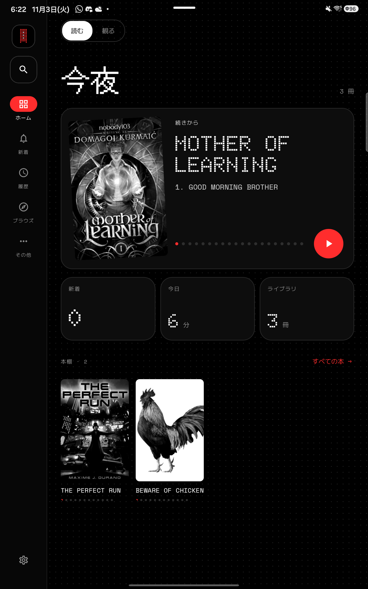
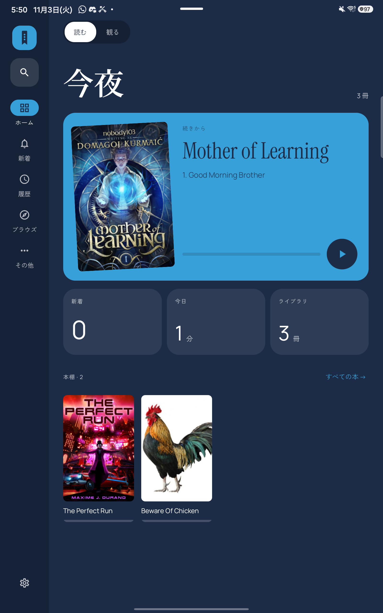
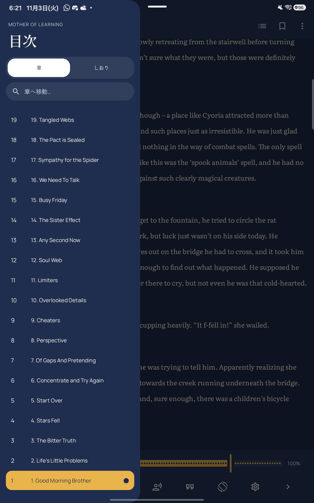
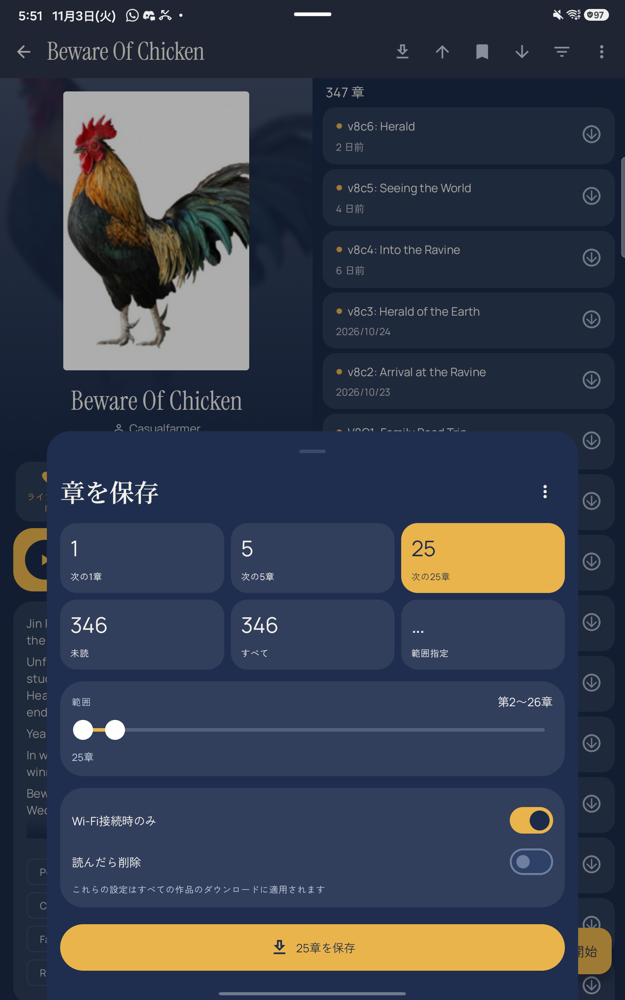
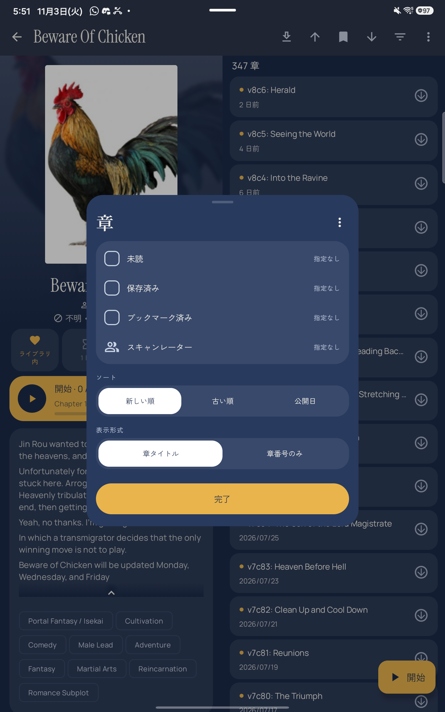
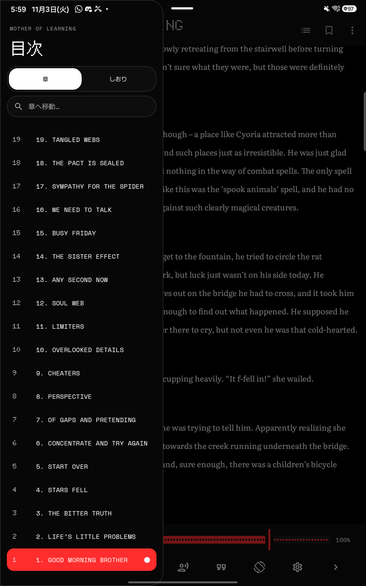
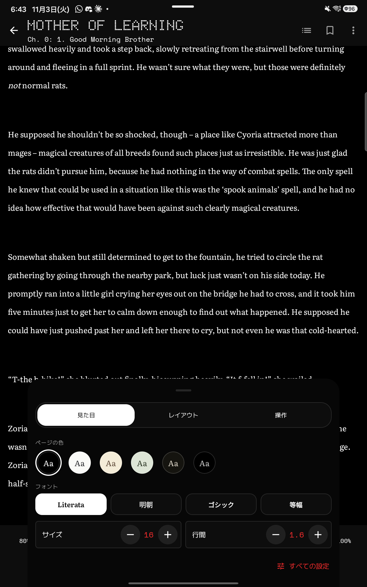

<div align="center">

# Tsuzuki · 続き

**One reader for light novels, web novels, manga and manhwa, with anime on the way.**

*Tsuzuki* means "continuation": what happens next.






</div>

---

## Two themes, one layout

| **Colour** | **Dot** |
|---|---|
| The whole app takes on the colours of the book you're reading. Instrument Serif + Manrope. | Monochrome dot-matrix with a single red accent; covers in greyscale. Doto + Space Mono. |

Switch between them instantly in **Settings › Appearance**. Japanese text gets a matching partner font in each theme.

## What's in it

**From Tsundoku / Mihon**
- Mihon-style extensions for manga and manhwa, plus **300+ LNReader novel sources** running natively
- Novel reader with text-to-speech, translation, paged or scrolling layout
- EPUB / TXT import, backups, LNReader backup import, trackers

**New in Tsuzuki**
- **Bento Home**: a "continue reading" hero, today's reading time, and your shelf
- Redesigned **library** (novels and manga together or apart), **book details**, **history**, **updates**, **browse** and **settings**
- **Save chapters** sheet: next 1 / 5 / 25, unread, all, or a custom range
- **Chapter filter & sort** on one page
- **Reader contents drawer**: jump to any chapter, bookmarks, read and downloaded marks
- **Reader settings**: page colours (Book, Paper, Sepia, Sage, Night, Black), font, size, line height, margins and controls, all applied live
- Phone **pill nav** and tablet **rail** layouts

<div align="center">




</div>

## Roadmap

- [ ] Anime: sources and player from Aniyomi, in the same library
- [ ] Separate download engines for manga, novels and anime, plus Mihon's newer download speed-ups
- [ ] Motion: shared-element transitions and theme reveal
- [ ] Reading streaks and goals, a listen tile, source health
- [ ] More translations (English and Japanese today)
- [ ] First release (v0.1)

The full plan is in [`docs/PLAN.md`](docs/PLAN.md); the ordered task queue is in [`AGENTS.md`](AGENTS.md).

## Status

**Early development: not released yet.** Builds run on phones and tablets, but expect rough edges.

## Building

You need Android Studio's JDK 21 and the Android SDK.

```sh
export JAVA_HOME="/path/to/Android Studio/jbr"   # JDK 21
./gradlew :app:assembleDebug                      # APKs in app/build/outputs/apk/debug/
```

The debug app installs as `io.github.manojx2005.tsuzuki.dev` next to any release build. First-time setup:
[`docs/GETTING_STARTED.md`](docs/GETTING_STARTED.md).

## Contributing

Help is very welcome: Compose UI, downloads, the anime integration, translations, or testing on your devices.

- Start with [`AGENTS.md`](AGENTS.md): build steps, rules, and the task queue (the first unchecked task is the next one).
- Every screen has a design board in [`docs/design/boards/`](docs/design/boards/INDEX.md) (PNG + HTML) with written
  specs in [`docs/design/specs.md`](docs/design/specs.md), so you never have to guess a layout.
- New UI lives in `tsuzuki` packages and upstream files get only small hooks, which keeps merges clean.
- Taking fixes from Mihon or Tsundoku: [`docs/UPSTREAM.md`](docs/UPSTREAM.md).

## Where it comes from

Tsuzuki is a fork of **[Tsundoku](https://github.com/tsundoku-otaku/tsundoku)**, which is a fork of
**[Mihon](https://github.com/mihonapp/mihon)**. Tsundoku brought the novel reader, TTS, translation and LNReader
support; Mihon brought the foundation. Upstream changes reach Tsuzuki users only through Tsuzuki releases.

## Credits and licences

- Code: Apache License 2.0 ([LICENSE](LICENSE)). Copyright the Mihon and Tsundoku contributors, and the Tsuzuki
  contributors. The original Tsundoku README is kept at [`docs/TSUNDOKU_README.md`](docs/TSUNDOKU_README.md).
- LNReader plugin logic: MIT (LNReader contributors).
- Bundled fonts (Doto, Space Mono, Instrument Serif, Manrope, Literata, and for Japanese DotGothic16, M PLUS 1 Code,
  Noto Serif JP, Zen Kaku Gothic New): SIL Open Font License 1.1 ([`docs/licenses/`](docs/licenses/)).

Tsuzuki is not affiliated with Mihon, Tsundoku or LNReader.
